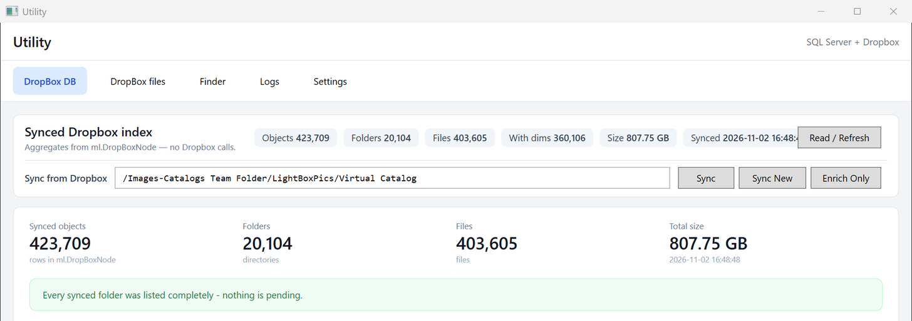

# Utility

**A Windows desktop app for one job: finding the images a media library has lost, and
putting them back.**

A catalogue arrives in Dropbox. A media library is built from it — every original, and
every derivative made from it. Over the years files go missing: a disk is wiped, a drive is
retired, a folder is moved. The catalogue still has them. The library does not.

**Utility reads both and tells you, row by row, what is missing.**



## The five tabs

| Tab | What it is for |
|---|---|
| **DropBox DB** | The synced index — every folder and file the catalogue walk has seen, with its size and its image dimensions — and the three buttons that sync it. |
| **DropBox files** | A browser for the catalogue. The same folders the sync walks, browsable, with a **Sync From Here** button that starts the walk from the branch you are looking at. |
| **Finder** | The library's image pairs, each with a **verdict**: what the app would do about it. This is the screen that finds the damage. |
| **Logs** | Every run the app has made — the recovery logs, one per run, and the app's own. |
| **Settings** | The SQL connection, the Dropbox app key and token, the retry budget. |

## The three syncs

All three live on the **DropBox DB** tab, and the difference between them is what they spend.

| | |
|---|---|
| **Sync** | The one-phase walk: every folder, every file's metadata fetched as it goes. Straight, and expensive. |
| **Sync New** | The two-phase walk: list the structure first, then fetch metadata for **only the files whose content changed**. An unchanged file costs no call. |
| **Enrich Only** | The second phase on its own: the files a previous sync marked as changed, and nothing else. Needs no path. |

On the **DropBox files** tab, **Sync From Here** runs the two-phase walk from the branch in
the address bar, and limits the enrichment to that branch. A branch is thirty-five files;
the namespace is four hundred thousand. The scope is the point.

## The Finder

The Finder walks the library and pairs every **child** with its **parent** — the original
it was made from. For each pair it works out a **verdict**:

| The pair | The verdict |
|---|---|
| both files open | **nothing to do** |
| the parent is missing, the original was found | **restore parent** |
| the child is missing, the parent opens | **regenerate child** |
| both are missing, the original was found | **restore parent, then regenerate child** |
| something is missing, candidates exist but none matches by size | **no original — needs a decision** |
| something is missing, no candidates at all | **cannot restore** |

**Recover Selected** repairs the pairs the filters are showing, after telling you exactly
what it will do. **Liem's List** is the report of what it could not fix — a decision needs
a human.

## The words the app uses

| | |
|---|---|
| **Pair** | one parent row and one child row in the library |
| **Parent** / **Child** | the original, and the derivative made from it |
| **Missing** | not on disk where it belongs, or there but no longer readable as an image |
| **Verdict** | what the app would do about a pair, worked out from the two files' states and the Dropbox match |
| **Original** | the Dropbox file the parent was most probably imported from — decided by matching, not recorded |
| **Candidate** | an indexed Dropbox file that might be that original |
| **Liem's List** | the report of the pairs that could not be repaired |

## Installation

### What you need

| | |
|---|---|
| **Windows** | the app is a WPF desktop application |
| **.NET** | the 10 SDK to build it, the 10 desktop runtime to run it |
| **SQL Server** | a database carrying the `ml` schema — the media library's tables. The app writes one table of its own, `ml.DropBoxNode`, and no others |
| **Dropbox** | an app of your own with a **refresh** token, created at <https://www.dropbox.com/developers/apps> |

The `ml` schema belongs to the system that owns the media library. This app reads those
tables and never writes to them.

### 1. Build it

```
git clone https://github.com/j124650/Utility.git
cd Utility
dotnet build Utility.slnx
```

### 2. Create the app's table

```
sqlcmd -S <server> -d <database> -E -I -i src/Utility.Server/Sql/CreateDropBoxNode.sql
```

`sqlcmd` comes with the SQL Server client tools. `-I` is required: the table has PERSISTED
computed columns, and SQL Server rejects them when QUOTED_IDENTIFIER is off. The `ml`
schema must already exist — the script creates the table inside it, not the schema.

**THE SCRIPT DROPS AND RECREATES THE TABLE.** On a fresh database that is what you want.
On an existing installation it destroys every synced row: use the `Alter*.sql` scripts in
`src/Utility.Server/Sql/` instead, which add one change at a time and are safe to run
again.

### 3. Run it, then configure it

```
dotnet run --project src/Utility.UI
```

Open the **Settings** tab: the SQL Server card takes the connection string, the Dropbox
card takes the app key, the app secret if you have one, and the refresh token. **Save
all** writes them to the registry, and the registry is what the app reads:

| | |
|---|---|
| `HKCU\Software\BbcUtility\Sql` | the SQL connection string and the timeouts |
| `HKCU\Software\BbcUtility\DropBox` | the app key, the app secret and the refresh token |

Nothing secret is in the repository — the app reads no connection string and no token from
a file in it — and the token in the registry is a **refresh** token, not an access token.

**Save all takes effect on the next start**, so restart the app afterwards.

### 4. Check it

**Test connection** reports that the connection worked; it does not say which database it
reached. The **DropBox DB** tab shows the index — the folders and files the sync has
walked, and how many of them have their image dimensions. It is empty until the first
sync.

To exercise a change against a copy of the database rather than the live one, follow
[the sandbox procedure](docs/sandbox-database-testing-spec.md).

## The documents

Every feature has a specification under [`docs/`](docs), written before it was built and
updated as it was measured. The ones to read first:

| | |
|---|---|
| [`finder-spec.md`](docs/finder-spec.md) | the Finder: the pairs, the verdicts, the filters |
| [`finder-recover-spec.md`](docs/finder-recover-spec.md) | what **Recover Selected** writes, and when it asks first |
| [`sync-new-spec.md`](docs/sync-new-spec.md) | the two-phase sync |
| [`sync-from-here-spec.md`](docs/sync-from-here-spec.md) | syncing one branch instead of the whole namespace |
| [`liems-list-spec.md`](docs/liems-list-spec.md) | the report of what could not be fixed |

`docs/agents/` holds how the agents that work in this repository behave.
